<a href="https://github.com/theinhtetaung-dev">
  <picture>
    <source media="(prefers-color-scheme: dark)" srcset="assets/profile-dark.svg">
    
  </picture>
</a>

[LinkedIn](https://www.linkedin.com/in/thein-htet-aung-22435a393/) · [Email](mailto:theinhtetaung.developer@gmail.com) · [GitHub](https://github.com/theinhtetaung-dev)

<picture>
  <source media="(prefers-color-scheme: dark)" srcset="assets/about-dark.svg">
  
</picture>

---

### Featured Work

  
  

  
  

---

### Technologies & Tooling

<picture>
  <source media="(prefers-color-scheme: dark)" srcset="assets/stack-dark.svg">
  
</picture>

---

### Engineering Focus

* **Backend development:** REST APIs, MVC applications, database-connected systems, and maintainable server-side code.
* **Software design:** Object-Oriented Programming, design patterns, Clean Architecture, and clear separation of concerns.
* **Reliability:** Authentication and authorization, concurrency, validation, and predictable data access.
* **Growth:** Learning through real-world projects, deliberate practice, and continuous refinement.
