<a href="https://github.com/theinhtetaung-dev">
  <picture>
    <source media="(prefers-color-scheme: dark)" srcset="assets/profile-dark.svg">
    
  </picture>
</a>

[LinkedIn](https://www.linkedin.com/in/thein-htet-aung-22435a393/) · [Email](mailto:theinhtetaung.developer@gmail.com) · [GitHub](https://github.com/theinhtetaung-dev)

I am an undergraduate student at the **Myanmar Institute of Information Technology (MIIT)**, passionate about programming, software development, and problem solving. I build backend applications with **.NET** and enjoy turning software engineering concepts into practical, maintainable projects.

My current focus is the .NET ecosystem—ASP.NET Core Web API, ASP.NET MVC, Blazor, and Entity Framework Core—alongside clean architecture, authentication and authorization, database design, and real-world backend project structure.

---

### Featured Work

| Project | What it explores | Stack |
| :--- | :--- | :--- |
| [YaungMel_POS](https://github.com/theinhtetaung-dev/YaungMel_POS) | A point-of-sale system with a .NET Web API, database migrations, and Docker support | C# / TypeScript |
| [RPS-Flask-Arduino](https://github.com/theinhtetaung-dev/RPS-Flask-Arduino) | An AI vision Rock–Paper–Scissors game with Flask and Arduino integration | C++ |
| [HotPot-Restaurant](https://github.com/theinhtetaung-dev/HotPot-Restaurant) | A hot-pot reservation system covering table, booking, and expiration management | C# / HTML |
| [opom-hsum-chaint-csharp](https://github.com/theinhtetaung-dev/opom-hsum-chaint-csharp) | A monastery and donation-management platform with a .NET API and Next.js admin portal | C# / Next.js |

---

### Technologies & Tooling

<picture>
  <source media="(prefers-color-scheme: dark)" srcset="assets/stack-dark.svg">
  
</picture>

---

### Engineering Focus

* **Backend development:** REST APIs, MVC applications, database-connected systems, and maintainable server-side code.
* **Software design:** Object-Oriented Programming, design patterns, Clean Architecture, and clear separation of concerns.
* **Reliability:** Authentication and authorization, concurrency, validation, and predictable data access.
* **Growth:** Learning through real-world projects, deliberate practice, and continuous refinement.
